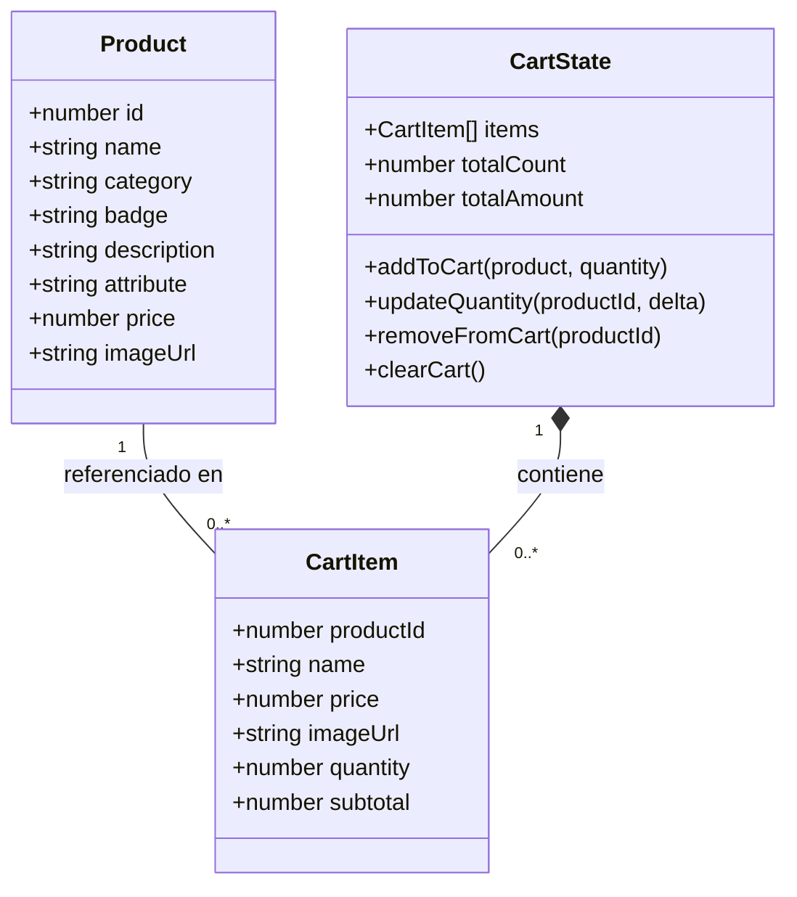
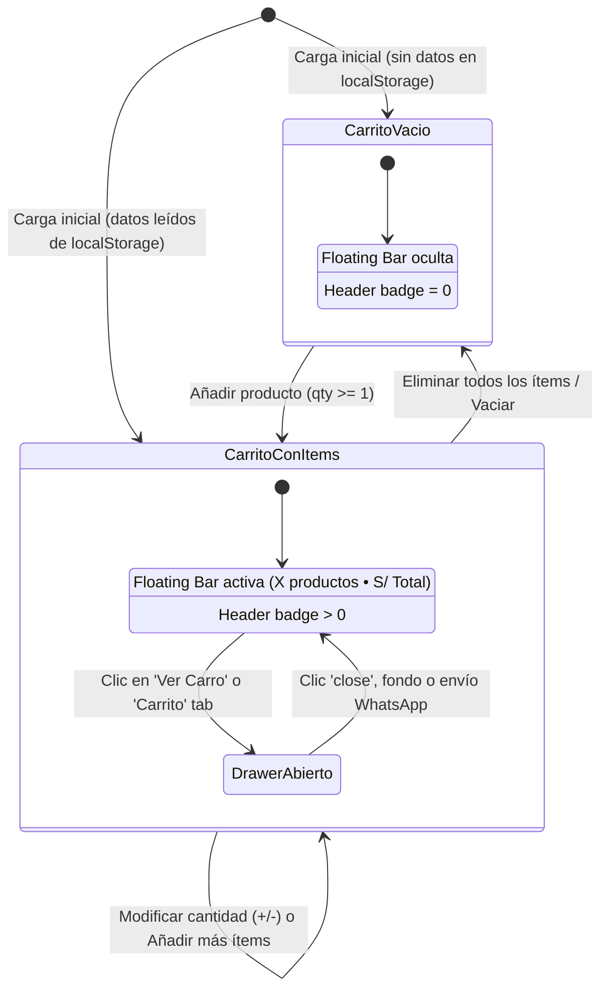

# Data Model: Módulo 001 - Catálogo Interactivo y Adición al Carrito

**Feature**: `001-catalogo-y-categorias`  
**Date**: 2026-10-25  
**Status**: Completed  

---

## 1. Entidades del Dominio



---

## 2. Definición Detallada de Entidades

### 2.1. Product (Producto del Catálogo)
Representa un artículo disponible en la tienda para su exhibición y venta.

| Campo | Tipo | Requerido | Descripción | Ejemplo |
|-------|------|-----------|-------------|---------|
| `id` | `number` | Sí | Identificador único numérico | `1` |
| `name` | `string` | Sí | Nombre comercial del producto | `"Nova Sonic Max"` |
| `category` | `string` | Sí | Categoría a la que pertenece | `"Audio"` |
| `badge` | `string` | Sí | Insignia superior visual en la imagen | `"Audio Pro"` |
| `description` | `string` | Sí | Frase corta descriptiva o tecnología | `"Cancelación activa"` |
| `attribute` | `string` | Sí | Detalle secundario o estado de stock | `"Stock listo"` |
| `price` | `number` | Sí | Precio unitario expresado en Soles (S/) | `199.00` |
| `imageUrl` | `string` | Sí | URL pública de la imagen de Stitch | `"https://lh3.googleusercontent.com/..."` |

### 2.2. CartItem (Ítem en el Carrito de Compras)
Representa un producto que ha sido seleccionado por el usuario con una cantidad específica.

| Campo | Tipo | Requerido | Reglas de Validación |
|-------|------|-----------|-----------------------|
| `productId` | `number` | Sí | Coincide con `Product.id`. |
| `name` | `string` | Sí | Copiado del producto para renderizado rápido. |
| `price` | `number` | Sí | Precio unitario fijo al agregarlo (>= 0). |
| `imageUrl` | `string` | Sí | URL de la imagen para miniaturas en el Drawer. |
| `quantity` | `number` | Sí | Entero positivo restringido entre `1` y `99`. |
| `subtotal` | `number` | Sí | Calculado automáticamente como `price * quantity`. |

### 2.3. CartState (Estado Consolidado del Carrito)
Estructura global gestionada a través de React Context y sincronizada en cliente.

| Propiedad / Método | Tipo / Firma | Descripción |
|--------------------|--------------|-------------|
| `items` | `CartItem[]` | Lista reactiva de artículos en la orden actual. |
| `totalCount` | `number` | Sumatoria total de unidades (`Σ quantity`). |
| `totalAmount` | `number` | Monto monetario acumulado (`Σ subtotal`), redondeado a 2 decimales. |
| `addToCart` | `(product: Product, quantity: number) => void` | Añade unidades o incrementa si el ítem ya existe. |
| `updateQuantity` | `(productId: number, delta: number) => void` | Incrementa/decrementa (`+1` o `-1`). Si `quantity < 1`, remueve. |
| `removeFromCart` | `(productId: number) => void` | Elimina el ítem de la orden. |
| `clearCart` | `() => void` | Vacía todos los ítems y restablece totales a 0. |

---

## 3. Esquema de Persistencia en LocalStorage

- **Clave de almacenamiento**: `"novastore_cart_v1"`
- **Formato**: JSON serializado.
- **Estructura de carga/guardado**:

```json
[
  {
    "productId": 1,
    "name": "Nova Sonic Max",
    "price": 199.00,
    "imageUrl": "https://lh3.googleusercontent.com/aida-public/...",
    "quantity": 2,
    "subtotal": 398.00
  },
  {
    "productId": 2,
    "name": "Apex Horizon GPS",
    "price": 149.50,
    "imageUrl": "https://lh3.googleusercontent.com/aida-public/...",
    "quantity": 1,
    "subtotal": 149.50
  }
]
```

- **Resiliencia ante fallos**:
  - Si el valor leído en `localStorage` es nulo, inválido o falla al parsearse con `JSON.parse()`, el hook inicializa el estado con un arreglo vacío `[]` y limpia la clave corrupta de forma silenciosa.

---

## 4. Transiciones de Estado y Ciclo de Vida



