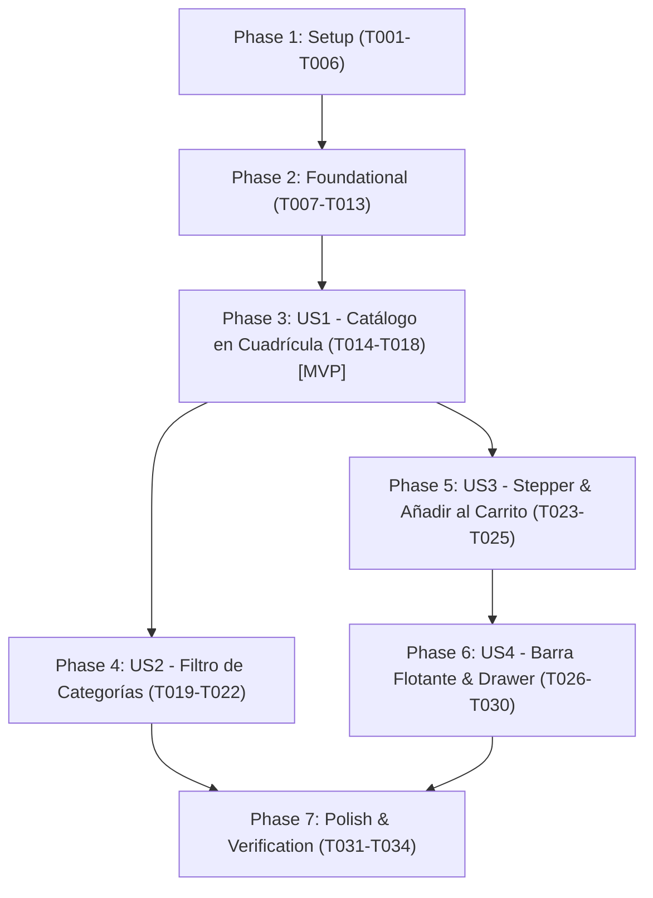

# Tasks: Módulo 001 - Catálogo Interactivo de Productos y Adición al Carrito

**Input**: Design documents from `/specs/001-catalogo-y-categorias/` (`spec.md`, `plan.md`, `data-model.md`, `research.md`, `contracts/`, `quickstart.md`)  
**Prerequisites**: `plan.md`, `spec.md`, `data-model.md`, `contracts/`, `research.md`  
**Tests**: Se incluyen pruebas unitarias y de componentes con Vitest y React Testing Library conforme a `AGENTS.md` (`npm test`).  
**Organization**: Tareas agrupadas por fases y por historias de usuario para permitir desarrollo e integración incremental e independiente.

---

## Phase 1: Setup (Shared Infrastructure)

**Purpose**: Inicialización del proyecto React con Vite, configuración de Tailwind con tokens de Stitch y entorno de pruebas.

- [x] T001 Initialize React project with Vite, dependencies (`react`, `react-dom`), devDependencies (`vite`, `@vitejs/plugin-react`, `tailwindcss`, `postcss`, `autoprefixer`, `vitest`, `@testing-library/react`, `@testing-library/jest-dom`, `jsdom`) and scripts (`dev`, `build`, `test`) in `package.json`
- [x] T002 [P] Configure Vite and Vitest with jsdom environment in `vite.config.js`
- [x] T003 [P] Configure PostCSS in `postcss.config.js` and Tailwind CSS with exact colors, typography and spacing tokens from `stitch-referencias/modern_mobile_commerce/DESIGN.md` in `tailwind.config.js`
- [x] T004 [P] Setup HTML entry point loading Inter font (`wght@400;500;600;700`) and Google Material Symbols Outlined in `index.html`
- [x] T005 [P] Setup base CSS directives and safe-area utilities (`pb-safe`, `pt-safe`, scrollbar hidden) in `src/index.css`
- [x] T006 [P] Configure testing setup and jest-dom matchers in `tests/setup.js`

---

## Phase 2: Foundational (Blocking Prerequisites)

**Purpose**: Infraestructura central de datos, constantes de WhatsApp, formateadores y contexto de carrito con persistencia en `localStorage`.

- [x] T007 Create static catalog dataset with 6 products from Stitch reference in `src/data/products.json` with fields `id` (number), `name` (string), `category` (enum: "Audio"|"Wearables"|"Accesorios"|"Hogar"), `badge` (string), `description` (string), `attribute` (string), `price` (number in Soles: 199.00, 149.50, 89.50, 129.00, 110.00, 68.00), and `imageUrl` (Google Cloud Storage URL)
- [x] T008 [P] Define application configuration and centralized destination WhatsApp number `WHATSAPP_PHONE_NUMBER = "51999999999"` in `src/config/constants.js`
- [x] T009 [P] Implement currency formatting utility strictly formatted as `S/ [monto]` (2 decimal places) in `src/utils/formatters.js`
- [x] T010 [P] Implement WhatsApp URL and structured message builder per `contracts/whatsapp-order-url.md` using `encodeURIComponent` in `src/utils/whatsapp.js`
- [x] T011 Implement `CartContext` and `CartProvider` managing `items`, `totalCount`, `totalAmount`, `addToCart`, `updateQuantity`, `removeFromCart` and `clearCart`, synchronized with `localStorage` key `"novastore_cart_v1"` in `src/context/CartContext.jsx`
- [x] T012 [P] Implement custom hook `useCart` for easy consumer access to `CartContext` in `src/hooks/useCart.js`
- [x] T013 [P] Write unit tests for `CartContext` operations and `localStorage` JSON recovery and corruption handling in `tests/context/CartContext.test.jsx`

---

## Phase 3: User Story 1 - Exploración y Visualización del Catálogo en Cuadrícula (Priority: P1) 🎯 MVP

**Goal**: Visualizar el catálogo de 6 productos en una cuadrícula responsiva de 2 columnas con imagen, badge, título, subtítulo, disponibilidad y precio en Soles (S/), junto al encabezado superior fijo.  
**Independent Test**: Cargar la aplicación y verificar que se visualizan el encabezado 'NOVA STORE - Catálogo' y las 6 tarjetas de producto en 2 columnas con diseño idéntico a Stitch.

### Tests for User Story 1
- [x] T014 [P] [US1] Write component test verifying ProductCard renders name, badge, description, attribute and price in `tests/components/ProductCard.test.jsx`

### Implementation for User Story 1
- [x] T015 [P] [US1] Implement base ProductCard presentation layout matching `stitch-referencias/vista_principal_del_cat_logo/code.html` in `src/components/ProductCard.jsx`
- [x] T016 [P] [US1] Implement fixed Header component with store logo, 'NOVA STORE - Catálogo' and cart shopping_bag badge in `src/components/Header.jsx`
- [x] T017 [US1] Implement ProductGrid component rendering the 2-column layout (`grid grid-cols-2 gap-gutter-sm`) in `src/components/ProductGrid.jsx`
- [x] T018 [US1] Assemble root application container and mount `CartProvider`, `Header` and `ProductGrid` in `src/App.jsx` and `src/main.jsx`

**Checkpoint**: User Story 1 (MVP) completada e independientemente verificable en navegador.

---

## Phase 4: User Story 2 - Filtrado Dinámico por Categorías (Priority: P2)

**Goal**: Filtrar interactivamente los productos del catálogo mediante píldoras horizontales ('Todos', 'Audio', 'Wearables', 'Accesorios', 'Hogar') y exhibir el micro-banner de envíos gratis.  
**Independent Test**: Pulsar sobre 'Audio' y validar que la cuadrícula muestra únicamente 2 productos; pulsar sobre 'Todos' y validar que reaparecen los 6.

### Tests for User Story 2
- [x] T019 [P] [US2] Write component test for category pill selection and active state toggle in `tests/components/CategoryPills.test.jsx`

### Implementation for User Story 2
- [x] T020 [P] [US2] Implement CategoryPills horizontal slider component with 5 category options and active pill styling in `src/components/CategoryPills.jsx`
- [x] T021 [P] [US2] Implement AnnouncementBanner micro-banner component with text "Envíos express prioritarios en 24h a todo el país - GRATIS" in `src/components/AnnouncementBanner.jsx`
- [x] T022 [US2] Integrate `CategoryPills` and `AnnouncementBanner` into `src/App.jsx` and connect active category filter state to `ProductGrid.jsx`

**Checkpoint**: User Stories 1 y 2 completamente funcionales e integradas.

---

## Phase 5: User Story 3 - Ajuste de Cantidad y Adición al Carrito (Priority: P1)

**Goal**: Habilitar el stepper (`−` y `+`, 1-99) en cada tarjeta, agregar la cantidad al carrito con feedback visual '✓ Listo' en verde por 1 segundo, reiniciar a 1 y persistir en `localStorage`.  
**Independent Test**: Ajustar cantidad a 2 con `+`, presionar 'Añadir', verificar estado '✓ Listo', reinicio a 1, aumento en el badge del header y persistencia tras recargar la pestaña.

### Tests for User Story 3
- [x] T023 [P] [US3] Write tests for stepper boundary controls (min 1, max 99) and add-to-cart micro-interaction in `tests/components/ProductCard.test.jsx`

### Implementation for User Story 3
- [x] T024 [US3] Implement interactive stepper buttons (`−` and `+` constrained to [1, 99]) and rapid add-to-cart handler with 1.1s temporary '✓ Listo' state in `src/components/ProductCard.jsx`
- [x] T025 [US3] Connect ProductCard add action to `useCart().addToCart()` and add bounce/pulse animation to header cart badge in `src/components/Header.jsx`

**Checkpoint**: User Story 3 completada con reactividad y persistencia en `localStorage`.

---

## Phase 6: User Story 4 - Resumen Rápido en Barra Flotante y Cajón Deslizable (Priority: P2)

**Goal**: Mostrar barra flotante inferior fija (`quick-order-bar`) con total acumulado (oculta si totalItems === 0), desplegar Drawer modal 'Tu Orden Actual' al presionar 'Ver Carro' o tab 'Carrito', y enviar pedido por WhatsApp cerrando el drawer.  
**Independent Test**: Agregar productos, comprobar que aparece la barra flotante con total en Soles, abrir el Drawer, presionar 'Confirmar Pedido vía WhatsApp' y validar generación de enlace wa.me y cierre del modal.

### Tests for User Story 4
- [x] T026 [P] [US4] Write component test for CartDrawer open/close transitions and QuickOrderBar visibility in `tests/components/CartDrawer.test.jsx`

### Implementation for User Story 4
- [x] T027 [P] [US4] Implement QuickOrderBar fixed floating bar with item count, total in Soles, pulse dot and 'Ver Carro' button in `src/components/QuickOrderBar.jsx`
- [x] T028 [P] [US4] Implement CartDrawer slide-up modal with backdrop, header, items list, total in Soles and 'Confirmar Pedido vía WhatsApp' CTA in `src/components/CartDrawer.jsx`
- [x] T029 [P] [US4] Implement BottomNav fixed bottom tab navigation with 4 tabs ('Catálogo' active, 'Carrito' wired to open Drawer) in `src/components/BottomNav.jsx`
- [x] T030 [US4] Integrate QuickOrderBar, CartDrawer and BottomNav in `src/App.jsx` with WhatsApp checkout handler per `contracts/whatsapp-order-url.md`

**Checkpoint**: Las 4 historias de usuario operativas y cubiertas end-to-end.

---

## Phase 7: Polish & Cross-Cutting Concerns

**Purpose**: Verificación de compilación, ejecución de tests automatizados y validación de los escenarios del quickstart.

- [x] T031 Execute full test suite with `npm test` and verify 100% pass rate in tests
- [x] T032 Execute production build with `npm run build` to confirm zero bundle errors
- [x] T033 Execute manual quickstart verification scenarios 1 to 5 from `specs/001-catalogo-y-categorias/quickstart.md` in browser
- [x] T034 Verify repository hygiene, ensuring no private keys or secrets are committed and `WHATSAPP_PHONE_NUMBER` is easily configurable in `src/config/constants.js`

---

## Dependencies & Execution Order

### Phase Dependencies

### User Story Dependencies

- **US1 (P1)**: Depende únicamente de la Fase 2 (Foundational). Constituye el MVP inicial.
- **US2 (P2)**: Depende de US1 (se monta sobre la cuadrícula del catálogo).
- **US3 (P1)**: Depende de US1 y del estado de CartContext (Fase 2).
- **US4 (P2)**: Depende de US3 (requiere ítems en el carrito para activar la barra flotante y el Drawer).
- **Polish**: Depende de la finalización de todas las historias de usuario.

---

## Parallel Execution Opportunities

### Phase 1 (Setup)
- `T002`, `T003`, `T004`, `T005`, `T006` pueden ejecutarse en paralelo una vez completado `T001`.

### Phase 2 (Foundational)
- `T008` (`constants.js`), `T009` (`formatters.js`), `T010` (`whatsapp.js`) pueden desarrollarse en paralelo con `T007` (`products.json`).
- `T012` (`useCart.js`) y `T013` (`CartContext.test.jsx`) pueden ejecutarse en paralelo una vez creado `T011` (`CartContext.jsx`).

### Phase 3 (US1)
- `T014` (test), `T015` (`ProductCard.jsx`), `T016` (`Header.jsx`) pueden desarrollarse en paralelo antes de la integración en `T017` y `T018`.

### Phase 4 (US2)
- `T019` (test), `T020` (`CategoryPills.jsx`), `T021` (`AnnouncementBanner.jsx`) pueden desarrollarse en paralelo.

### Phase 6 (US4)
- `T026` (test), `T027` (`QuickOrderBar.jsx`), `T028` (`CartDrawer.jsx`), `T029` (`BottomNav.jsx`) pueden desarrollarse en paralelo antes de la integración en `T030`.

---

## Implementation Strategy

### MVP First (User Story 1 Only)
1. Ejecutar Fase 1: Setup (`package.json`, `vite.config.js`, `tailwind.config.js`, `index.html`, `index.css`).
2. Ejecutar Fase 2: Foundational (`products.json`, constantes, `formatters.js`, `CartContext.jsx`).
3. Ejecutar Fase 3: User Story 1 (`ProductCard.jsx`, `Header.jsx`, `ProductGrid.jsx`, `App.jsx`).
4. **Verificar MVP**: Abrir navegador y comprobar renderizado de catálogo de 6 productos en 2 columnas con precios en Soles.

### Entrega Incremental
1. Añadir Fase 4 (Filtro por Categorías) -> Probar filtrado reactivo independiente.
2. Añadir Fase 5 (Stepper + Adición reactiva con microinteracción) -> Probar persistencia en `localStorage`.
3. Añadir Fase 6 (Barra flotante + Drawer modal + WhatsApp) -> Probar flujo de pedido hacia WhatsApp.
4. Ejecutar Fase 7 (Polish) -> `npm test` y `npm run build` limpios.

