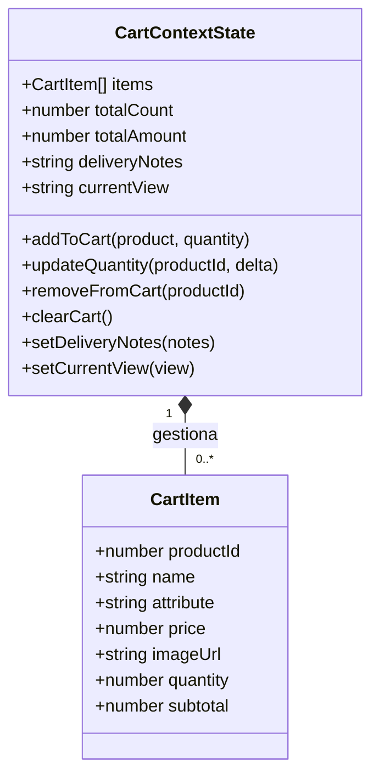
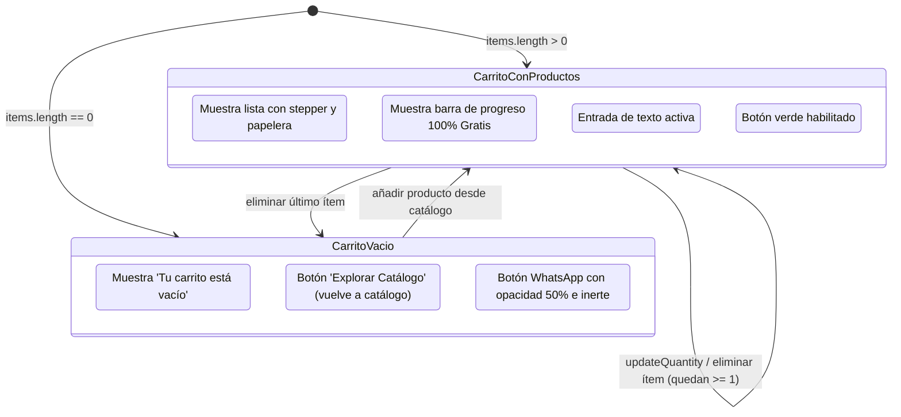

# Data Model: Módulo 002 - Gestión Completa del Carrito y Checkout vía WhatsApp

**Feature**: `002-carrito-y-pedidos-whatsapp`  
**Date**: 2026-10-25  
**Status**: Completed  

---

## 1. Diagrama de Clases y Entidades

---

## 2. Definición Detallada de Campos

### 2.1. CartItem (Ítem en el Carrito)
| Campo | Tipo | Requerido | Descripción | Regla de Validación |
|-------|------|-----------|-------------|---------------------|
| `productId` | `number` | Sí | Identificador único del producto | Entero positivo |
| `name` | `string` | Sí | Nombre comercial del producto | No vacío |
| `attribute` | `string` | No | Subtítulo descriptivo o categoría | Texto corto |
| `price` | `number` | Sí | Precio unitario en Soles | Positivo (`price >= 0`) |
| `imageUrl` | `string` | Sí | URL de la miniatura | URL válida de Stitch |
| `quantity` | `number` | Sí | Cantidad seleccionada | Rango `[1, 99]`. Si `delta < 1`, se elimina. |
| `subtotal` | `number` | Sí | Monto calculado | `price * quantity` |

### 2.2. CartContextState (Estado Global Ampliado)
| Propiedad | Tipo | Descripción |
|-----------|------|-------------|
| `items` | `CartItem[]` | Colección de productos seleccionados |
| `totalCount` | `number` | Total de unidades (`Σ quantity`) |
| `totalAmount` | `number` | Total monetario en Soles (`Σ subtotal`) |
| `deliveryNotes` | `string` | Instrucciones opcionales del cliente |
| `currentView` | `'catalogo' \| 'carrito'` | Vista activa en la interfaz de usuario |

---

## 3. Máquina de Estados del Carrito en 'Tu Pedido'

